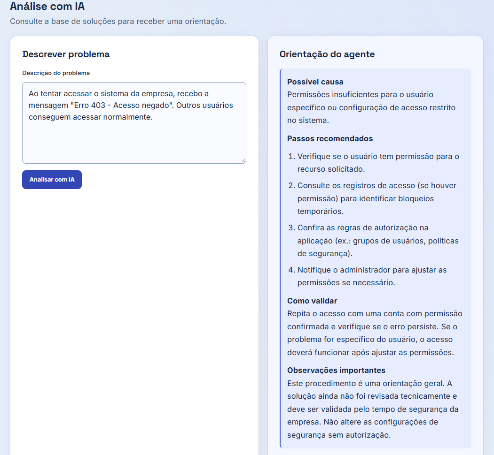

# InsightDesk AI

Sistema de gerenciamento de chamados de suporte técnico com inteligência artificial, desenvolvido como projeto de portfólio para aplicar conhecimentos de desenvolvimento web, banco de dados e integração de IA.

O sistema permite registrar e acompanhar chamados técnicos, além de consultar um agente de inteligência artificial que utiliza uma base de conhecimento para sugerir possíveis causas e procedimentos de resolução.

## Funcionalidades

- Cadastro de chamados com título e descrição.
- Listagem e acompanhamento dos chamados registrados.
- Atualização de status: aberto, em andamento e resolvido.
- Dashboard com indicadores de chamados.
- Análise de problemas técnicos com inteligência artificial.
- Análise individual de chamados cadastrados.
- Consulta a uma base de soluções armazenada no PostgreSQL.
- Busca híbrida, combinando similaridade semântica e correspondência textual.
- Apresentação de orientações técnicas, possíveis causas e procedimentos de validação.

## Demonstração do sistema

### Análise de chamados com inteligência artificial

O InsightDesk AI permite descrever problemas técnicos e receber orientações geradas por um agente de IA, incluindo possíveis causas, procedimentos recomendados e formas de validação.



## Tecnologias utilizadas

### Frontend
- Vue 3
- JavaScript
- HTML e CSS
- Vite
- Marked e DOMPurify para exibição segura de respostas em Markdown

### Backend
- Python
- FastAPI
- OpenAI Agents SDK

### Banco de dados
- PostgreSQL
- pgvector para armazenamento e consulta de embeddings

### Inteligência artificial
- Ollama para execução local dos modelos
- Qwen3:4b para geração das respostas
- nomic-embed-text para geração de embeddings
- RAG (Retrieval-Augmented Generation)

## Como funciona

O InsightDesk AI possui duas funcionalidades principais: gerenciamento de chamados e análise técnica com IA.

No gerenciamento de chamados, o frontend envia requisições à API FastAPI, que realiza as operações necessárias no PostgreSQL.

Na análise com IA, o fluxo funciona da seguinte forma:

1. O usuário descreve um problema técnico ou seleciona um chamado cadastrado.
2. O frontend envia a descrição para a API.
3. O agente de IA utiliza uma ferramenta para consultar a base de soluções.
4. O sistema realiza uma busca híbrida, combinando correspondência textual e similaridade semântica por embeddings.
5. Um filtro seleciona as soluções consideradas mais relevantes.
6. As informações recuperadas são disponibilizadas ao agente como contexto.
7. O modelo de linguagem gera uma orientação técnica com possíveis causas, procedimentos recomendados e formas de validação.

Essa abordagem utiliza RAG para apoiar as respostas com informações cadastradas na base de conhecimento.

As sugestões geradas pela IA devem ser verificadas antes de sua aplicação em ambientes reais.

## Estrutura do projeto

```text
insightdesk-ai/
├── frontend/
├── agente.py
├── ferramentas.py
├── database.py
├── gerar_embeddings.py
├── main.py
├── schema.sql
├── seed.sql
├── requirements.txt
├── .env.example
├── .gitignore
└── README.md
```

## Como executar localmente

### Pré-requisitos

- Python
- Node.js e npm
- PostgreSQL com extensão pgvector
- Ollama
- Git

### 1. Clonar o repositório

```bash
git clone https://github.com/catharinavlb/insightdesk-ai.git
cd insightdesk-ai
```

### 2. Configurar o banco de dados

O InsightDesk AI utiliza PostgreSQL com a extensão pgvector para armazenar chamados, soluções técnicas e embeddings.

**1. Criar o banco de dados**

Utilizando o pgAdmin ou o terminal PostgreSQL, crie um banco chamado `insightdesk_ai`:

```sql
CREATE DATABASE insightdesk_ai;
```

**2. Criar as tabelas**

Conecte-se ao banco `insightdesk_ai` e execute o arquivo `schema.sql`.

Esse script habilita a extensão `vector` e cria as tabelas `chamados` e `solucoes`.

**Observação:** a extensão pgvector precisa estar instalada no servidor PostgreSQL para que o comando `CREATE EXTENSION vector` funcione.

**3. Inserir os dados de exemplo**

No mesmo banco, execute o arquivo `seed.sql`.

Esse script cadastra quatro soluções técnicas fictícias que serão utilizadas pela base de conhecimento do agente de IA.

**4. Configurar as variáveis de ambiente**

Na pasta principal do projeto, crie um arquivo `.env` utilizando `.env.example` como referência:

```dotenv
DB_HOST=localhost
DB_PORT=5432
DB_NAME=insightdesk_ai
DB_USER=postgres
DB_PASSWORD=sua_senha_local
```

Substitua os valores pelas configurações do seu PostgreSQL.

O arquivo `.env` contém informações locais de conexão e não deve ser publicado no GitHub.

**5. Gerar os embeddings**

Após instalar as dependências Python e os modelos do Ollama, siga as instruções da seção **4. Preparar os modelos de IA** para gerar os embeddings das soluções cadastradas.


### 3. Preparar o backend

Na pasta principal do projeto, crie um ambiente virtual Python:

```powershell
python -m venv .venv
```

Ative o ambiente virtual no Windows PowerShell:

```powershell
.\.venv\Scripts\Activate.ps1
```

Instale as dependências do projeto:

```powershell
python -m pip install -r requirements.txt
```

O arquivo `requirements.txt` contém as bibliotecas utilizadas pelo backend, incluindo FastAPI, Uvicorn, Psycopg e OpenAI Agents SDK.

### 4. Preparar os modelos de IA

Com o Ollama instalado, baixe os modelos:

```bash
ollama pull qwen3:4b
ollama pull nomic-embed-text
```
Inicie o serviço do Ollama, caso ele não esteja em execução.
Após instalar as dependências Python, configurar o PostgreSQL, executar os scripts `schema.sql` e `seed.sql` e baixar os modelos do Ollama, gere os embeddings das soluções:

```powershell
python gerar_embeddings.py
```

Execute esse comando na pasta principal do projeto, com o ambiente virtual Python ativado e o serviço Ollama em funcionamento.

Os embeddings são armazenados no PostgreSQL e utilizados na busca semântica do sistema. Para uma instalação nova, essa etapa deve ser executada antes de utilizar a análise com IA.


O modelo `qwen3:4b` é utilizado para gerar as orientações técnicas, enquanto `nomic-embed-text` é responsável pela representação vetorial dos textos.

### 5. Executar o backend

Na pasta principal do projeto:

```bash
python -m uvicorn main:app --host 127.0.0.1 --port 8000
```

A documentação interativa da API ficará disponível em:

`http://127.0.0.1:8000/docs`

### 6. Executar o frontend

Em outro terminal:

```bash
cd frontend
npm install
npm run dev
```

Acesse a aplicação no endereço indicado pelo Vite, normalmente:

`http://localhost:5173`

**Observação:** a execução completa requer um banco PostgreSQL configurado e populado com soluções técnicas, além dos embeddings correspondentes. O repositório ainda não inclui um processo automatizado de preparação inicial do banco.

## Objetivo do projeto

O InsightDesk AI foi desenvolvido para colocar em prática conceitos de:

- Desenvolvimento e integração de aplicações frontend e backend.
- Criação e consumo de APIs REST.
- Modelagem, armazenamento e consulta de dados relacionais.
- Integração de modelos de linguagem em aplicações.
- Recuperação de informações com RAG e busca vetorial.
- Organização de um projeto de software para portfólio.

## Status

Primeira versão funcional, desenvolvida para fins de estudo e portfólio.

## Autoria

Desenvolvido por [Catharina](https://github.com/catharinavlb).